

<h1> MINECRAFT VLA</h1>
 
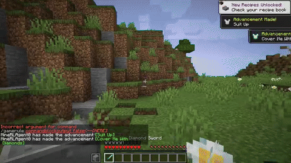

# Abstract

This was an attempt at implementing the ActVLP Post-training policy for Minecraft VLA agents from the (https://arxiv.org/pdf/2503.16365) paper and use it to post-train a VLM from scratched. In this re-implementation, we didn't care much to stick exactly to the paper's implementation but rather to see if that same policy could yield anything significant on a much smaller model, and on a much more restrained amount of compute, this is hence more of a research work I guess than a plain re-implement.
We were hence able to post-train Qwen3-VL-2B-Instruct 2B parameters on around 35H H100 x1 hours and get significant results mainly on mob killing despite the much more restrained resources we were working with. We also skipped the fine-tuning stage due to these same compute restrictions but this could be an interesting follow up to see if the impact of larger action-chunks also translates on a much smaller model.

# Table of Contents :

- [Post-training policy](#post-training-policy)
- [Model](#model)
- [Compute](#compute)
- [Challenges](#challenges)
- [Results](#results)
- [Mistakes](#mistakes)
- [Comments](#comments)
- [What's next](#whats-next)
- [Ressources](#ressources)

# Post-training Policy 

 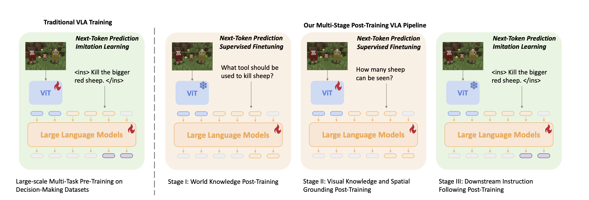
 

This project mainly focused on re-implementing the ActVLP Post-training policy from the JarvisVLA paper (https://arxiv.org/pdf/2503.16365)
and using it on the same provided dataset to see how good of a MC VLA we could get our of a 2B parameter VLA.

The ActVLP training policy consists of the following 3 stages: 

### Stage 1 : World knowledge Post-Training

In the first stage, we only train the LLM (i.e the ViT weights are off and there is no image token inputs) on Minecraft world knowledge questions, here is a sample of the kind of questions we trained on:

| Question | Answer |
|---|---|
| What materials are required to make a stick in Minecraft? | To make a stick in Minecraft, you need one wooden plank. |
| What is the blast resistance of dirt in Minecraft? | The blast resistance of dirt in Minecraft is 2.5. |
| Can skeletons spawn in any biome or only specific ones? | Skeletons can spawn in any biome in Minecraft. |

We ran a single epoch on the provided dataset which is around 100M loss tokens (i.e in the assistant portion of the row as we don't compute loss for the user section).
This is the smallest stage out of the three.

### Stage 2 : Visual Knowledge and Spatial Grounding Post-Training

In this stage, we trained the both the ViT and LLM portions of the VLM (with requires_grad = True on all parameters basically) on a varied dataset of tasks that go from describing an image, pointing to specific points on an image, image captioning, GUI pointing (i.e pointing at specific points on the GUI) :

 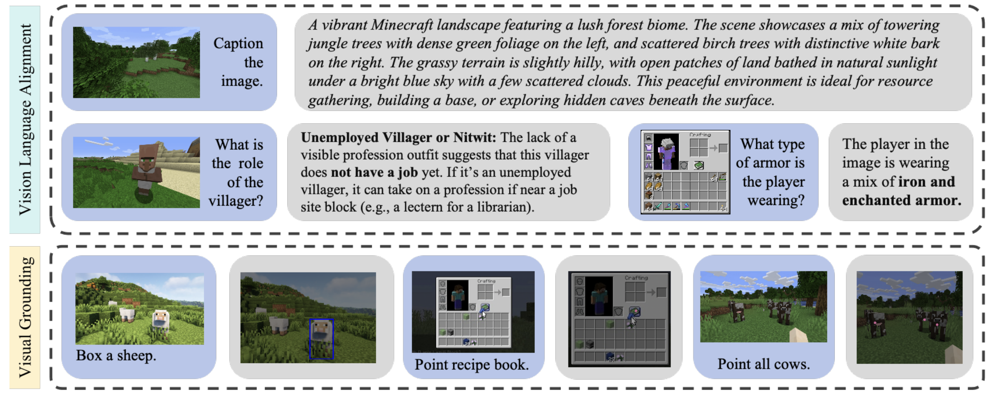
 

We also trained on one epoch on all 5 of our datasets (shuffled) which resulted in around 81M seen tokens 

### Stage 3 : Gameplay Action training 

This stage was the bulk of the Post-training, we use Action-Chunks of size 1 (so no action chunking) per the paper as judged more efficient, we also introduced 251 new action token to the ChatML dictionary to encode 75 actions, we followed the Mu-Law camera movement quantization as per the paper for a better movement "lattice" than a uniform one. 

Here is a sample of the kind of action sequences we were training on :

 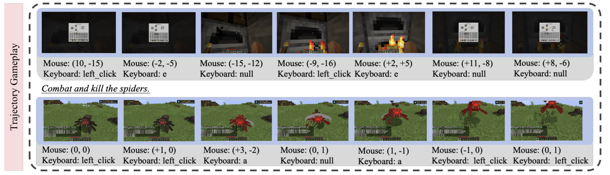
 

This was by far the heaviest stage of post-training and the most important one, we only ran one epoch over the 100GB dataset with around 1B tokens seen.

# Model

We used the 2B parameter version of Qwen3VL Instruct VLM (https://huggingface.co/Qwen/Qwen3-VL-2B-Instruct), this choice was made in an effort to match the paper which used Qwen2VL Instruct at 7B parameters. We hoped to get some improved performance by using the more recent version of the model despite knowing that a 2B model parameter would be limiting, but due to the cost of renting GPUs, I could not afford anything better than that.

 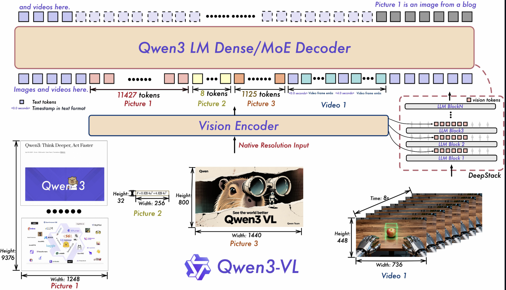
 

# Compute 

This is where we diverge the most from the paper (which is linked to model selection), we only ran Post-training on 34 GPU Hours on a single H100 80Gb which dwarfs the 640 GPU Hours on their 32 A800 80Gb cluster. The exact number of epochs isn't mentioned but we can guess that the extra compute must have been used for Phase 3 as training those new action tokens is most important. The paper also mentions a fine-tuning stage where they basically re-ran phase 3, but this time with Action chunking of size 3 which DID prove to significantly improve performance, but due to those same restrictions, we were unable to complete that phase. (ts already cost me 150$, and I did not feel like not paying my rent next month to fully post-train the model or going for a larger model)

 
 

# Challenges

Working on restricted compute and restricted money really makes you feel how important engineering is as a part of research, and a lot of that comes down to knowing your OS class material and most importantly iterating. The challenging part was to find the right batch size that would not too often mid run, to fully utilize our GPU, which was a lot of iteration which took about 2 hours on the rented machine which added time pressure to the job. Moreover we also tried to avoid bottlenecks on data-loading (specifically in phase 3) by using concurrent programming (we used I believe 16 data loader processes) but this wasn't too challenging as the machine provided by Lambda had 30 CPU cores which made it easy to fit. Other than that, a lot of the job was Data Parsing, Data Loading and training loop writing, which changes from my different projects which were more involving on the model building part of things. I also honestly offloaded all of the evaluation part to Claude as I did not feel like learning all of MineStudio. And Claude lowkey gave me some sloppy tests and crashes, which thankfully due to the fact that they are image recorded since running in Minecraft I could spot as soon as a saw it but which yet remind us that delegating all of our job to AI is not (yet) an option. (Though I believe some iterations could have fixed it). I was still able nonetheless to get really good tests and footage on Mob killing and Crafting (it messed up block mining).

# Results :

Honestly, on one hand our VLA did pretty bad for all Smelting/Crafting/Enchantement related tasks, which was expected as the GUI is pretty packed with options, and those are longer multi-step tasks that are sequential by nature, and where action-chunking fine-tuning would have helped. But on the other hand, the VLA was actually "pretty good" at killing mobs and fighting, despite a win rate of only around <b>16%</b>, we were able to get some quite impressive fighting skills from our VLA and some nice highlights from him as testify the following clips :

<table>
  <tr>
    <td align="center">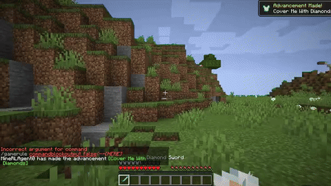 Killing wither skeleton</td>
    <td align="center">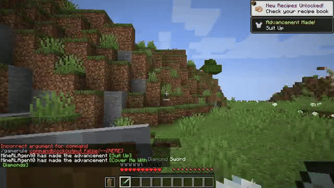 Fighting off creeper w/ shield</td>
  </tr>
  <tr>
    <td align="center">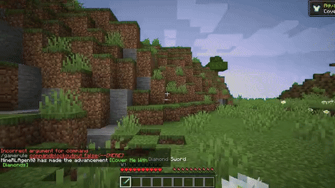 Killing zombified villager</td>
    <td align="center">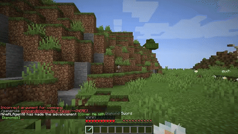 Mean mugging enderman</td>
  </tr>
  <tr>
    <td align="center">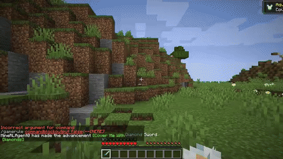 Killing husk</td>
    <td align="center">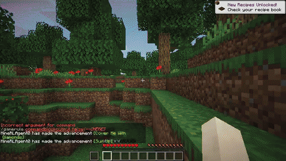 General "Alzhimer's" issue w/ crafting</td>
  </tr>
</table>

As we see the VLA is able with more or less struggles to catch some bodies, but a 16% success rate is still pretty low compared to what the paper claims to achieve (though our tests were pretty diversified, we sampled over 100+ different mobs so to really probe for generalized fighting skills), crafting on the other hand is still very difficult with pretty much all clips displaying alzhimers-like behavior with regards to the GUI

# Mistakes :

We did a couple mistakes, especially with regards to logging, I randomly sampled the train loss on phase 3 every 100 batches I believe, but since phase 3 is a shuffled mix of 5 datasets, it yielded a pretty ugly test loss curve due to the variance between the model accuracy with regards to the 5 datasets

 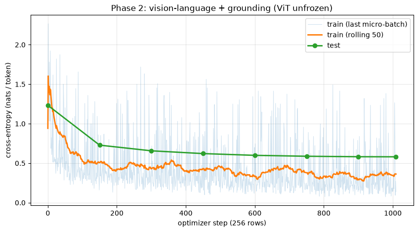
 

Other than that I also believe I should have made a bit more iteration on the MineStudio evaluation harness (Claude generated), as the mining tests were pretty sloppy which is why I chose to not publish them here, but since the benchmarking was also running on rented compute and I was already 150$ down, I chose to cut it there.

Moreover, maybe more efficient reading of the paper would have saved me a lot of times, as not knowing the ChatML format, I wrote a couple parsers that were nearly useless down the line.

# Comments :

On a more personal note, this was highkey one of the most interesting ML project I worked on, this time focusing a bit less on model building/architecture and more on the training pipeline, it felt way more like an engineering job which is always cool and makes some of the school material useful, moreover being paper-divergent also gives way more dopamine in the sense of 30 GPU hours in, I had no clue if I would actually get something reasonable our of a 4 times smaller VLA on 20x less compute which was exciting, and seeing the model actually kill mobs was quite enjoyable as it meant my money didn't "go to waste". Overall pretty interesting for someone that has interest in VLMs/CV/ML and systems too, I would advice as a cool learning experiment too.

# What's next : 

I would really like one day to see the effect of Action-Chunking and hence do a fine-tuning run on the model, especially since we didn't achieve any crafting success which is kinda frustrating but may be the area where action-chunking may help the most due to the sequential nature of crafting. I would also like to build a similar agent, but on a completely different architecture with something like a JEPA-V like model which I think would better fit my bank account and also allow me to better grasp how much more efficiency we could get out of fully working in the embedded space.

# Ressources :

I would like to thank the Team CraftJarvis, and Peking University for making all datasets available as without that, I would have not been able to train my VLM this easily.

Sources : 

Paper : https://arxiv.org/pdf/2503.16365

Phase I/II Datasets : https://huggingface.co/datasets/CraftJarvis/minecraft-vlp

Phase III Dataset : https://huggingface.co/datasets/CraftJarvis/minecraft-vla-sft

My weights : https://huggingface.co/achraf00921/jarvis-vla-qwen3-2b/tree/main

